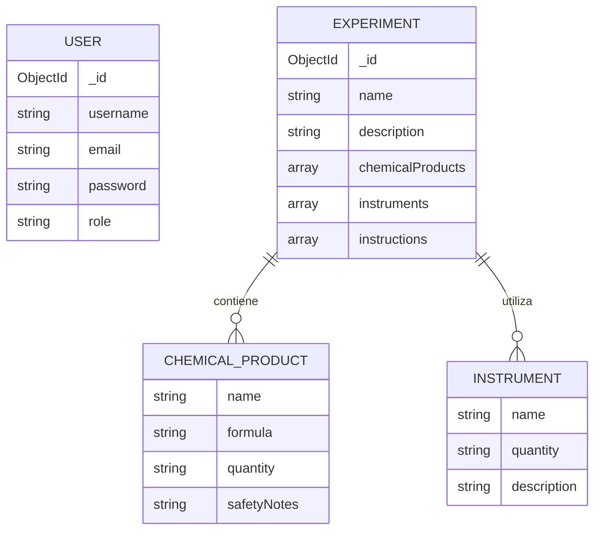

# My Chemical Playbook - Memoria Técnica

*My Chemical Playbook* es una API educativa para consultar experimentos de química, sus sustancias químicas, instrumentos y instrucciones de realización.

## Índice

1. Descripción de la API
2. MongoDB y diseño de datos
3. Modelo de datos
4. Arquitectura
5. Seguridad
6. Endpoints
7. Testing
8. Retos y soluciones
9. Mejoras futuras

## 1. Descripción de la API

La API permite registrar usuarios y gestionar una colección de experimentos científicos destinados a fines educativos y lúdicos.

### 1.1. Problema que resuelve

El proyecto centraliza la información necesaria para realizar un experimento:

- Nombre y descripción.
- Objetivos educativos.
- Sustancias químicas utilizadas.
- Instrumentos necesarios.
- Instrucciones de realización.

### 1.2. Usuarios y roles

| Rol | Permisos |
|---|---|
| Anónimo | Consultar los contenidos públicos. |
| `user` | Registrarse, iniciar sesión, consultar y buscar experimentos. |
| `admin` | Gestionar usuarios y contenidos, además de tener los permisos de un usuario. |

### 1.3. Entidades principales

| Entidad | Persistencia | Descripción |
|---|---|---|
| `User` | Colección | Datos de acceso y rol del usuario. |
| `Experiment` | Colección | Experimento completo y datos relacionados. |
| `ChemicalProduct` | Subdocumento embebido | Sustancia química incluida dentro de un experimento. |
| `Instrument` | Subdocumento embebido | Instrumento utilizado en un experimento. |

## 2. Por qué MongoDB

MongoDB es adecuado porque cada experimento puede almacenarse como un documento independiente que contiene toda su información descriptiva.

Los productos químicos e instrumentos se embeben dentro del experimento porque:

- Se consultan habitualmente junto con este.
- Normalmente no necesitan existir de forma independiente.
- Evitan operaciones adicionales para recuperar un experimento completo.
- Permiten conservar su información en el contexto en que se utilizan.

Con SQL sería necesario modelar al menos:

- `users`
- `experiments`
- `chemical_products`
- `instruments`
- `experiment_chemical_products`
- `experiment_instruments`

Esto implicaría más tablas, claves foráneas y consultas `JOIN`. MongoDB reduce esa complejidad de lectura para una API centrada en documentos completos.

MongoDB sería una opción menos conveniente si los productos químicos o instrumentos necesitaran muchas relaciones independientes, validación compartida o actualizaciones masivas comunes.

## 3. Modelo de datos

### 3.1. Diagrama



### 3.2. Decisiones de diseño

Los usuarios se almacenan como documentos independientes porque pueden autenticarse y tener privilegios propios.

Los experimentos se almacenan como documentos independientes porque representan el recurso principal de la API.

Los productos químicos y instrumentos se embeben, ya que forman parte de una versión concreta del experimento y se recuperan con él.

### 3.3. Identificadores

MongoDB utiliza `_id` de tipo `ObjectId` como identificador primario.

Los subdocumentos embebidos no deben considerarse entidades globales independientes. Si cada sustancia o instrumento debe reutilizarse y gestionarse por separado, podrían referenciarse mediante `_id`.

## 4. Arquitectura

La aplicación sigue una arquitectura organizada por capas:

```text
src
├── routes
├── controllers
├── services
├── models
└── middlewares
```

### 4.1. Rutas

Las rutas traducen las peticiones HTTP en operaciones de la API. Se encargan de:

- Definir el método y la URL.
- Asociar autenticación y autorización.
- Invocar al controlador correspondiente.

### 4.2. Controladores

Los controladores reciben y validan la entrada HTTP y construyen la respuesta. No deben contener toda la lógica de acceso a datos.

### 4.3. Servicios

Los servicios contienen la lógica de negocio y coordinan operaciones sobre los modelos.

### 4.4. Modelos

Los modelos definen los esquemas de Mongoose y las reglas de persistencia.

### 4.5. Middlewares

Los middlewares procesan las peticiones entre el enrutado y los controladores:

- Verificación del JWT.
- Comprobación de roles.
- Manejo de errores.
- Validación o transformación de datos.

## 5. Seguridad

### 5.1. Registro

El registro valida los datos recibidos y evita guardar contraseñas en texto plano. Antes de persistir el usuario, la contraseña se transforma mediante un algoritmo de hash.

### 5.2. Login

El usuario envía sus credenciales al endpoint de autenticación. La API verifica las credenciales y devuelve un token si son válidas.

### 5.3. JWT

El token contiene información mínima de identidad y autoría, como el identificador del usuario y su rol. Debe enviarse en solicitudes protegidas, normalmente mediante la cabecera:

```http
Authorization: Bearer <token>
```

El secreto de firma y la duración del token deben configurarse mediante variables de entorno.

### 5.4. Middleware `authenticate`

El middleware `authenticate`:

1. Extrae el token de la cabecera `Authorization`.
2. Comprueba su firma y caducidad.
3. Obtiene la identidad y el rol.
4. Añade el usuario autenticado a la petición.

Las solicitudes sin token válido son rechazadas.

### 5.5. Middleware `requireRole`

El middleware `requireRole` comprueba si el usuario autenticado posee uno de los roles permitidos.

Por ejemplo, solo un `admin` puede crear, modificar o eliminar experimentos.

### 5.6. Permisos sobre recursos

Los usuarios autenticados pueden consultar sus propios datos solo si el diseño de la API lo permite. Las operaciones administrativas deben estar protegidas por el rol `admin`.

### 5.7. CORS

CORS controla qué dominios pueden realizar solicitudes desde el navegador. En desarrollo puede permitir el origen del cliente local; en producción debería limitarse a los dominios autorizados.

### 5.8. Búsqueda segura

Las búsquedas deben validar y normalizar el texto recibido para evitar parámetros inesperados o consultas NoSQL inseguras.

Los datos de entrada no deben enviarse directamente como operadores MongoDB. Los textos de búsqueda deben escaparse o limitarse a expresiones permitidas.

## 6. Endpoints

Los endpoints siguientes deben contrastarse con las rutas reales del proyecto:

| Método | Endpoint | Acceso | Descripción |
|---|---|---|---|
| `POST` | `/auth/register` | Público | Registra un usuario |
| `POST` | `/auth/login` | Público | Inicia sesión y devuelve un JWT |
| `POST` | `/auth/logut` | Privado | Finaliza la sesión |
| `GET` | `/experiment` | Público | Lista experimentos |
| `GET` | `/experiment/:id` | Público | Obtiene un experimento |
| `POST` | `/experiment` | Privado | Crea un experimento |
| `PATCH` | `/experiment/:id` | Admin | Actualiza un experimento |
| `DELETE` | `/experiment/:id` | Admin | Elimina un experimento |
| `POST` | `/experiment/:id/chemicalProduct` | Privado | Crea un producto químico en un experimento |
| `DELETE` | `/experiment/:id/chemicalProduct/:cProductId` | Admin | Elimina un producto químico de un experimento |
| `POST` | `/experiment/:id/instrument` | Privado | Crea un instrumento en un experimento |
| `DELETE` | `/experiment/:id/instrument/:instrumentId` | Admin | Elimina un instrumento de un experimento |

Las rutas exactas, códigos de estado y formatos de respuesta deben verificarse contra el router definitivo.

## 7. Testing

El testing debe cubrir:

- Registro de usuario válido.
- Registro con datos inválidos o duplicados.
- Comparación correcta de contraseñas.
- Login correcto e incorrecto.
- Rechazo de rutas protegidas sin JWT.
- Rechazo de JWT caducado o inválido.
- Acceso denegado a usuarios sin el rol requerido.
- Creación, consulta, modificación y eliminación de experimentos.
- Validación de esquemas.
- Respuesta ante identificadores inexistentes o inválidos.
- Comportamiento de la búsqueda con parámetros normales y maliciosos.

Las pruebas pueden apoyarse en una base de datos aislada y datos preparados antes de cada ejecución.

## 8. Retos y soluciones

### 8.1. Representar relaciones químicas

**Problema:** un experimento puede contener varias sustancias e instrumentos.

**Solución:** se utilizaron subdocumentos embebidos para mantenerlos junto al experimento y simplificar las consultas.

### 8.2. Proteger operaciones administrativas

**Problema:** las operaciones de modificación deben estar disponibles solo para administradores.

**Solución:** separación de la autenticación JWT y la comprobación de roles mediante middlewares.

### 8.3. Gestión de datos sensibles

**Problema:** las contraseñas no deben almacenarse ni transmitirse sin protección.

**Solución:** almacenamiento de hash y uso de JWT para autenticación posterior.

## 9. Mejoras futuras

- Confirmar y documentar cada endpoint con ejemplos de respuestas.
- Añadir paginación y filtros.
- Añadir índice de texto o búsqueda avanzada.
- Incorporar límite de solicitudes para prevenir abuso.
- Añadir validación exhaustiva de entrada con esquemas.
- Añadir logs estructurados y seguimiento de errores.
- Crear tests de integración y extremo a extremo.
- Añadir documentación interactiva con Swagger u OpenAPI.
- Configurar variables de entorno para cada entorno.
- Añadir refresco de tokens si aumenta la duración de las sesiones.
- Considerar referencias si instrumentos y sustancias se convierten en recursos administrables.
- Añadir niveles de seguridad, advertencias o clasificación educativa para experimentos sensibles.